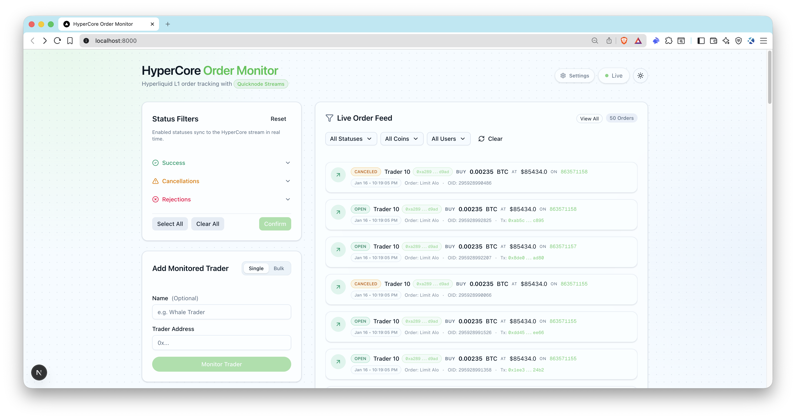

# HyperCore Order Monitor

HyperCore Order Monitor is a production-ready Next.js app that tracks **Hyperliquid Core (L1)** trading orders in real time using **[Quicknode Streams](https://www.quicknode.com/streams)** with **intelligent, real-time filtering powered by [Quicknode KV Store](https://www.quicknode.com/docs/key-value-store)**.

## Features

### **1. Real-Time Address Filtering**
Add or remove trader addresses through the UI (single or bulk import), and the **[Quicknode Streams](https://www.quicknode.com/streams)** filter updates **instantly** via **[KV Store](https://www.quicknode.com/docs/key-value-store)** lists. No stream restart required - start monitoring a whale trader and see their orders immediately.

### **2. Dynamic Status Filtering**
Toggle which order statuses you want to track (open, filled, cancelled, rejected, etc.) directly from the UI with a categorized status filter panel. Changes sync to **[KV Store](https://www.quicknode.com/docs/key-value-store)** in real-time, and the stream filter adjusts automatically - only the events you care about reach your webhook.

### **3. Blockchain-Native Filtering**
Filtering happens **at the stream level** using **[Quicknode Streams Filter](https://www.quicknode.com/docs/streams/filters)** and **[Quicknode KV](https://www.quicknode.com/docs/key-value-store)** lists, not in your application code. This means you only process the exact data you need - no wasted bandwidth or compute on irrelevant orders.

### **4. Real-Time UI Updates**
Live order feed with rich order details powered by Server-Sent Events (SSE) - see new orders appear instantly without polling.

### **5. Complete Setup Automation**
Pre-built scripts for **[Quicknode Streams](https://www.quicknode.com/streams)** setup and activation, plus Prisma migrations and database seeding - get up and running in minutes.


## Architecture

```
Hyperliquid Core (L1)
  -> Quicknode Streams + KV
    -> POST /api/webhook/streams (signature verified)
      -> OrderLog upsert + SSE emit
        -> Live UI order feed
```

## Prerequisites

- **Node.js 20+** and a package manager (pnpm/npm/yarn)
- **[Quicknode account](https://www.quicknode.com/signup)** with API key that has **Streams + KV access**
- **Public webhook URL** for local development (use [ngrok](https://ngrok.com) or similar tunneling service)
- **Git** for cloning the repository

**Optional** (for ENS name resolution):
- Ethereum mainnet RPC URL from [Quicknode](https://www.quicknode.com/signup)

## Environment Variables

| Variable | Required | Description | Where to Get |
|----------|----------|-------------|--------------|
| `QN_API_KEY` | **Yes** | Quicknode API key with Streams + KV access | [Quicknode Dashboard](https://dashboard.quicknode.com/api-keys) |
| `APP_URL` | **Yes** | Public webhook URL (must be reachable by Quicknode) | Use ngrok for local dev (see setup below) |
| `QN_STREAM_SECURITY_TOKEN` | **Yes** | Stream security token | Generated by `pnpm run setup:streams` |
| `DATABASE_URL` | **Yes** | SQLite database path | `file:./dev.db` (default) |
| `QN_EVM_ENDPOINT` | No | Ethereum RPC for ENS name resolution | [Quicknode Endpoints](https://www.quicknode.com/signup) |
| `ADMIN_API_KEY` | Production | API key for admin endpoint protection | Generate secure random string |
| `NEXT_PUBLIC_APP_NAME` | No | Application display name | `HyperCore Order Monitor` (default) |

**Important Notes:**
- **Never commit `.env` to git** - it contains sensitive credentials
- `QN_API_KEY` must have both Streams and KV permissions enabled
- `APP_URL` must be set **before** running `setup:streams` (it becomes the webhook destination)
- `ADMIN_API_KEY` is optional for local dev but **required** for production deployments

## Quickstart

### Step 1: Clone the Repo

```bash
git clone https://github.com/quiknode-labs/qn-hypercore-order-monitor.git
cd qn-hypercore-order-monitor
```

### Step 2: Install Dependencies

```bash
# Using pnpm
pnpm install

# OR using npm
npm install

# OR using yarn
yarn install
```

### Step 3: Set Up Environment Variables

```bash
cp .env.example .env
```

**⚠️ IMPORTANT:** Edit `.env` file **NOW** before proceeding. You must configure:

1. **`QN_API_KEY`**: Get from [Quicknode Dashboard](https://dashboard.quicknode.com/api-keys)
   - Ensure your API key has **Streams** and **KV** permissions enabled

2. **`APP_URL`**: Your public webhook URL (required for stream setup)
   - For local development, use ngrok (see below)
   - This URL must be publicly accessible by Quicknode

### Step 4: Set Up ngrok for Local Development

```bash
# Install ngrok (macOS)
brew install ngrok

# OR download from https://ngrok.com/download

# Start ngrok tunnel pointing to port 3000
ngrok http 3000
```

Copy the **https://** URL from ngrok output (e.g., `https://abc123.ngrok-free.app`) and add it to your `.env` file:

```bash
APP_URL="https://abc123.ngrok-free.app"
```

> **Tip:** Keep ngrok running in a separate terminal. The URL remains valid as long as ngrok is running.

### Step 5: Initialize Database

```bash
# Using pnpm
pnpm prisma migrate dev --name hypercore-order-monitor
pnpm db:seed

# OR using npm
npm run prisma migrate dev --name hypercore-order-monitor
npm run db:seed

# OR using yarn
yarn prisma migrate dev --name hypercore-order-monitor
yarn db:seed
```

**What `db:seed` does:**
- Creates all available status filters in the database
- Enables successful order statuses by default: `open`, `filled`, `triggered`
- Adds one sample trader address (`0xd48374090fe4df231f7002d592b6c67c4c875b1a`) to help you get started
- This sample address will be used for filter testing during stream creation (Step 6)
- The same address and activated statuses will be added to the **[KV Store](https://www.quicknode.com/docs/key-value-store)** lists during `setup:streams`

### Step 6: Create Quicknode Stream

```bash
# Using pnpm
pnpm run setup:streams

# OR using npm
npm run setup:streams

# OR using yarn
yarn run setup:streams
```

This script will:
1. Create KV lists for address and status filtering with initial data from the database
2. Test the filter on a known block
3. Create a paused stream with your `APP_URL` as the destination
4. Print a `QN_STREAM_SECURITY_TOKEN`

**Copy the security token** from the output and add it to your `.env` file:

```bash
QN_STREAM_SECURITY_TOKEN="qnsec_..."
```

### Step 7: Start the Application

```bash
# Using pnpm
pnpm dev

# OR using npm
npm run dev

# OR using yarn
yarn dev
```

### Step 8: Activate the Stream

```bash
# Using pnpm
pnpm run activate:streams

# OR using npm
npm run activate:streams

# OR using yarn
yarn run activate:streams
```

### Step 9: Add Traders and Watch Orders

1. Open [http://localhost:3000](http://localhost:3000)
2. Orders from monitored traders will start flowing to your webhook in real-time
3. **Add more traders** using the "Add Monitored Trader" form, **or** use bulk import with these sample whale traders:

```
0xf17de447fdfa1778db06111e3cbdc878332adab2, Whale 1
0x0b506be94c45382b11685cff769e5e76fcd8bd65, Whale 2
0x4911505cbb6cc71f71b59ef1ec0ee99f6c57a8a0, Whale 3
0xaa44894f7c04c77fcf2807576834b93f6a8cb844, Whale 4
0x4ce87901d7356250156afd04fef88ea492f53f88, Whale 5
0x019514701c6f9d887926b3b8da7444b69f57d4df, Whale 6
0x1ee7a73cb5b0b6b056d8138085b2009e6a6bedf5, Whale 7
0x7e280c1b204072a5f3e346fa57e0105d68ef6efd, Whale 8
0xa289ee1e56c0d5d041db762e6123e78af0f7d9ad, Whale 9
```

**When you add a trader:**
- The address is immediately added to the **[KV Store](https://www.quicknode.com/docs/key-value-store)** `userstream_hl_users` list
- The **[Quicknode Stream](https://www.quicknode.com/streams)** filter picks it up instantly - no restart needed
- Orders from this trader will start flowing to your webhook in real-time

**Customize tracked statuses:**
1. Click on the **Status Filter** panel in the UI
2. Toggle statuses on/off (e.g., enable `cancelled` and `rejected` to track failed orders)
3. Changes sync to the **[KV Store](https://www.quicknode.com/docs/key-value-store)** `userstream_hl_statuses` list immediately
4. The stream filter updates automatically - only enabled status orders reach your webhook

Once configured, orders matching your filters will stream in real-time!

## Screenshots



*Live order feed showing real-time trading activity from monitored Hyperliquid traders*

## Security

### Authentication

This application includes admin API endpoints that **must be protected in production**. For local development, authentication is optional.

#### Setting Up API Authentication

Add an admin API key to your `.env` file:

```bash
# Generate a secure random string (e.g., using openssl)
openssl rand -base64 32

# Add to .env
ADMIN_API_KEY="your-secure-random-key-here"
```

#### Protected Endpoints

The following endpoints require `Authorization: Bearer <ADMIN_API_KEY>` header:

- `POST /api/users` - Add monitored trader
- `POST /api/users/bulk` - Bulk add traders
- `PATCH /api/users` - Update trader info
- `DELETE /api/users` - Remove trader
- `GET /api/orders` - List orders
- `PATCH /api/statuses` - Update status filters
- `POST /api/statuses/reset` - Reset status filters

**Example authenticated request:**

```bash
curl -X POST http://localhost:3000/api/users \
  -H "Authorization: Bearer your-admin-api-key" \
  -H "Content-Type: application/json" \
  -d '{"walletAddress": "0x..."}'
```

#### Public Endpoints

- `GET /api/users` - List monitored traders (read-only)
- `GET /api/statuses` - List status filters (read-only)
- `POST /api/webhook/streams` - Quicknode webhook (uses signature verification)
- `GET /api/sse` - Server-Sent Events stream
- `GET /api/health` - Health check

**Note:** The webhook endpoint (`/api/webhook/streams`) uses Quicknode's signature verification and does **not** require the admin API key.

### Rate Limiting

The application implements basic rate limiting to prevent abuse:
- Bulk operations are limited to **50 addresses per request**
- Consider implementing additional rate limiting for production deployments

### Best Practices for Production

1. **Never commit `.env` to version control** - it contains sensitive credentials
2. **Rotate credentials regularly** - especially after team changes
3. **Use strong, randomly generated API keys** - minimum 32 characters
4. **Enable CORS restrictions** if deploying behind a specific domain
5. **Monitor logs** for unauthorized access attempts
6. **Use HTTPS** for all production deployments

### Responsible Disclosure

If you discover a security vulnerability, please:
1. **Do not** open a public GitHub issue
2. Email the maintainers or file a private security advisory
3. Provide details about the vulnerability and steps to reproduce

## Quicknode Streams Setup

Learn more about **[Quicknode Streams](https://www.quicknode.com/streams)** and **[KV Store](https://www.quicknode.com/docs/key-value-store)** in the official documentation.

The HyperCore filter is already provided:
- `filters/hl-orders-filter.js`

When you run `pnpm run setup:streams`, it will:
- Create **[KV lists](https://docs.quicknode.com/docs/kv-store)**: `userstream_hl_users` and `userstream_hl_statuses`
- Seed status list with `open`, `filled`, `triggered`
- Test the filter on a known block
- Create a stream (paused) and print the security token

You can override options with `key=value` arguments:

```bash
pnpm run setup:streams chain=hypercore-mainnet name="HyperCore Order Monitor" test_block_number=862932944
```

Activate the most recently created stream:

```bash
pnpm run activate:streams
```

For more details, see the **[Quicknode Streams Documentation](https://docs.quicknode.com/docs/streams)**.

## Status Filters

Order status filtering is implemented in two places:
- Database: `StatusFilter` table (source of truth)
- **[Quicknode KV](https://www.quicknode.com/docs/key-value-store)** list: `userstream_hl_statuses` (drives stream filter)

Default enabled statuses:
```
open, filled, triggered
```

Toggles in the UI call `/api/statuses` and sync to KV immediately.
If you need to reconcile KV with the database (for example after manual edits), run:
```
pnpm run sync:statuses
```

To reconcile monitored traders in KV with the database, run:
```
pnpm run sync:users
```

## Database

SQLite is used by default. Prisma schema lives in `prisma/schema.prisma`.

Common commands:

```
pnpm prisma migrate dev --name hypercore-order-monitor
pnpm db:seed
pnpm prisma studio
```

## Webhook Security and Payload

Webhook endpoint: `POST /api/webhook/streams`

Required headers:
- `x-qn-nonce`
- `x-qn-timestamp`
- `x-qn-signature`

Payload example:
- `docs/PAYLOAD-STRUCTURE.json`

The request can be gzip-compressed. The handler auto-detects `content-encoding: gzip`.

## API Endpoints

- `GET /api/health` - health check
- `GET /api/users` - list monitored traders
- `POST /api/users` - add trader (`walletAddress`, optional `name`)
- `PATCH /api/users?id=...` - update trader name/displayName
- `DELETE /api/users?id=...` - remove trader
- `POST /api/users/bulk` - bulk add (newline-separated, supports "address, label")
- `GET /api/orders` - list orders with filters
- `GET /api/statuses` - list status filters
- `PATCH /api/statuses` - update enabled status filters
- `POST /api/statuses/reset` - reset to default statuses
- `POST /api/webhook/streams` - Quicknode Streams webhook
- `POST /api/webhook/test` - local-only webhook test
- `GET /api/sse` - SSE stream of order events

## Project Structure

```
filters/
  hl-orders-filter.js        # HyperCore Streams filter
scripts/
  setup-streams.ts           # Creates KV lists + stream
  activate-streams.ts        # Activates stream by id
  reset-kv.ts                # Deletes HyperCore KV lists
prisma/
  schema.prisma              # SQLite schema
  seed.ts                    # Seeds StatusFilter defaults
src/
  app/                       # App Router routes + pages
  components/                # UI components
  lib/                       # Quicknode, webhook, SSE helpers
  types/                     # Shared types
docs/
  PAYLOAD-STRUCTURE.json     # Sample stream payload
```

## Scripts

```
pnpm dev
pnpm build
pnpm start
pnpm lint
pnpm typecheck
pnpm test
pnpm run setup:streams
pnpm run activate:streams
pnpm db:seed
pnpm reset:kv
pnpm sync:statuses
pnpm sync:users
```

## Testing

Unit tests use Vitest. Webhook and SSE routes have dedicated tests under `src/app/api/__tests__`.

```
pnpm test
```

## Troubleshooting

### Common Issues

**Missing webhook events:**
- Ensure `APP_URL` is publicly reachable and the stream is active
- Check that ngrok is still running (URLs expire when ngrok stops)
- Verify stream status in [Quicknode Dashboard](https://dashboard.quicknode.com)
- Check logs: `pnpm run activate:streams` should show stream as "running"

**401 Unauthorized from webhook:**
- Verify `QN_STREAM_SECURITY_TOKEN` matches the token from setup output
- Check Quicknode signature headers are present (`x-qn-signature`, `x-qn-timestamp`, `x-qn-nonce`)
- Ensure you haven't modified the webhook URL after stream creation

**KV list errors:**
- Confirm `QN_API_KEY` has **both** Streams and KV access enabled
- Check your [Quicknode Dashboard API Keys](https://dashboard.quicknode.com/api-keys) for permissions
- Verify KV lists exist: `userstream_hl_users` and `userstream_hl_statuses`

**ENS resolution issues:**
- Confirm `QN_EVM_ENDPOINT` points to Ethereum mainnet
- Get an Ethereum endpoint from [Quicknode](https://www.quicknode.com)
- ENS resolution is optional - addresses will work without it

**Authentication errors (401):**
- If you set `ADMIN_API_KEY`, ensure you're sending it in requests
- Check header format: `Authorization: Bearer <your-key>`
- For local development, `ADMIN_API_KEY` can be left empty

### Getting Help

- **[Quicknode Streams Guides](https://www.quicknode.com/guides/tags/streams)**
- **[Quicknode KV Store Docs](https://www.quicknode.com/docs/key-value-store)**
- **[Quicknode Support](http://support.quicknode.com/)**
- **GitHub Issues** for this repository

## License

MIT
